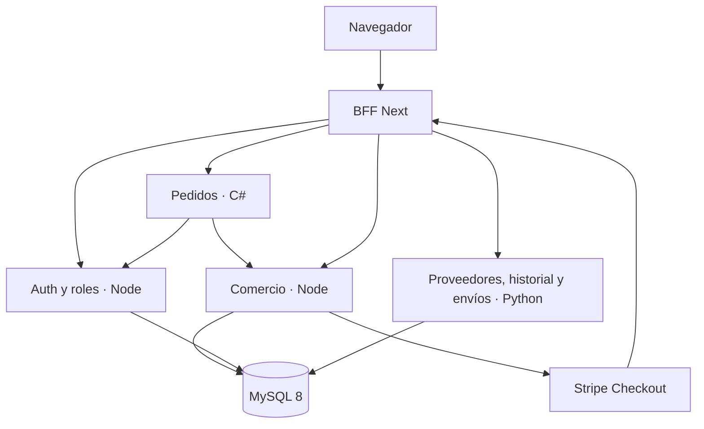
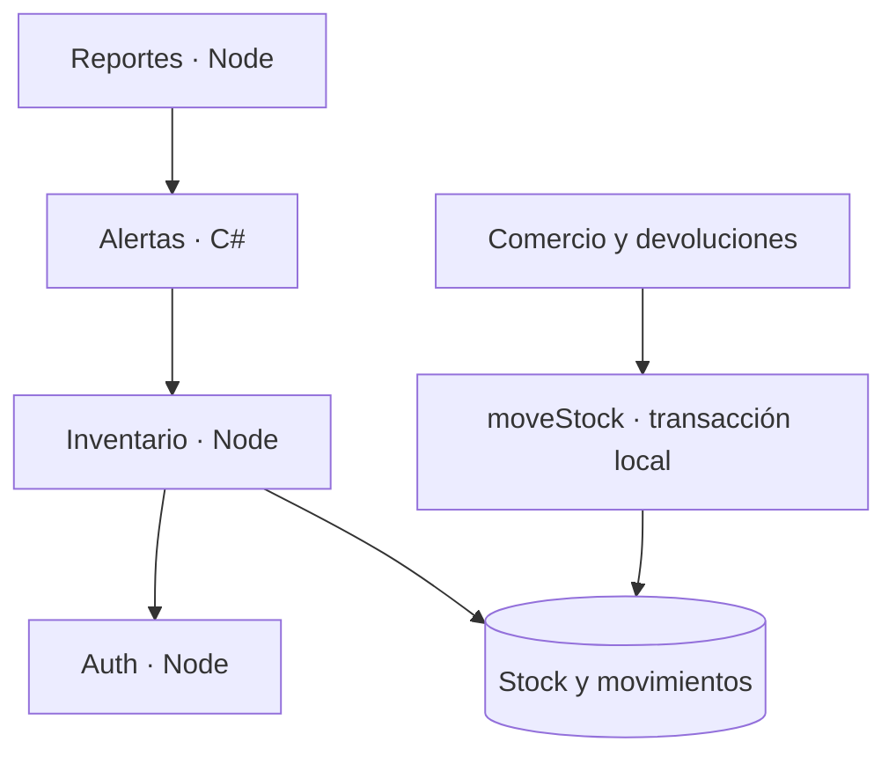

# Arquitectura SOA conservada

La interfaz sólo consume el BFF de Next. El BFF resuelve rutas de un registro cerrado, transporta JSON/PDF, administra la cookie HttpOnly y conserva el cuerpo firmado del webhook. No consulta MySQL ni calcula precios, stock o pagos.

## Fronteras y fuentes de verdad

Los 13 procesos tienen puerto, contrato y arranque propios. Comparten un esquema MySQL para mantener las relaciones académicas del modelo proporcionado. **No es una arquitectura de bases autónomas por microservicio**, ni se presenta como tal. Una separación física futura requeriría eventos, outbox e idempotencia adicionales; no se simuló una transacción distribuida.

| Dato | Responsable de escritura |
|---|---|
| Identidad, contraseña, sesiones, verificaciones | `auth`; `roles` cambia únicamente permisos y revoca sesiones en el mismo modelo. |
| Producto, imagen, oferta, ajuste | `inventory`. |
| Stock y bitácora | Operación canónica `packages/core/stock.mjs`, ejecutada en la misma transacción de ajuste, reserva, recepción o devolución. No hay otro saldo. |
| Carrito, domicilio, compra a proveedor, pedido coordinado, pago, venta, comprobante | `commerce`; `orders` valida por HTTP y delega el checkout. |
| Proveedor | Flask `suppliers`. |
| Posventa y reembolso | `returns`, con el mismo pedido/pago Stripe. |
| Envasado y paquete logístico | `packaging`, entidades distintas. Completar envasado no incrementa stock. |
| Guía y entrega | Flask `shipping`; una validación cambia el estado persistido del envío/pedido. |
| Reseña | `reviews`, con cliente derivado de la identidad. |
| Historial, reportes y alertas | Lectura de datos canónicos; no crean ventas ni inventario paralelo. |

## Consistencia

- Importes en centavos durante el cálculo y `DECIMAL` en MySQL; nunca confiar en totales del navegador.
- Reserva al crear el pedido mediante `SELECT ... FOR UPDATE`. Carrito, detalles, descuento, instantáneas y pago se guardan en una transacción local.
- Pedido, evento Stripe, venta y comprobante tienen claves de unicidad. El webhook repetido no vuelve a crear la venta.
- La llamada a Stripe ocurre fuera de cualquier supuesta transacción global; puede fallar después de crear el pedido. El historial permite reintentar, consultar o cancelar. No se declara cobrado por visitar una URL.
- Cancelación: Stripe debe confirmar la expiración. Si el cobro ganó la carrera, se confirma la venta y no se devuelve stock.
- Reembolso: se conserva su referencia; se recupera por metadata si hubo un corte antes de guardarla. Sólo `succeeded` marca una devolución como reembolsada. Un reembolso pendiente/erróneo no se anuncia como dinero devuelto.
- Cola persistente de comprobantes. Si SMTP falla, la venta permanece y el correo se reintenta. Un fallo entre aceptación SMTP y persistencia puede repetir el correo: SMTP no ofrece entrega exactamente una vez.

## Identidad y transporte

Auth comprueba estado, rol y versión de sesión contra MySQL. Los demás servicios consultan esa identidad por HTTP; C# pedidos consulta además el servicio de roles. No mantienen otra tabla de login. Cookies `HttpOnly`, `SameSite=Lax`, `Secure` cuando `APP_URL` usa HTTPS; comprobación de Origin para escrituras del navegador. Los servicios se enlazan a loopback y exigen `X-Service-Key`; el navegador nunca recibe esa clave.

`X-Correlation-Id` permite relacionar llamadas Node/Python/C#. Los logs registran servicio, ruta/estado y correlación, sin contraseñas, tokens ni cuerpos privados. Hay timeouts, errores normalizados y SQL parametrizado. Las escrituras HTTP no se reintentan indiscriminadamente.

## Interfaz

Se conserva la referencia de V2 y la cortina de V1 con nueve paneles y apertura desde el centro. Navegación superior y menú desplegable, sin sidebar. Colores claros, fotos y logo oficiales, iconos Lucide, GSAP como única biblioteca de animación. La interfaz muestra estados del servidor y estados de error; no sustituye fallos por operaciones de éxito.
