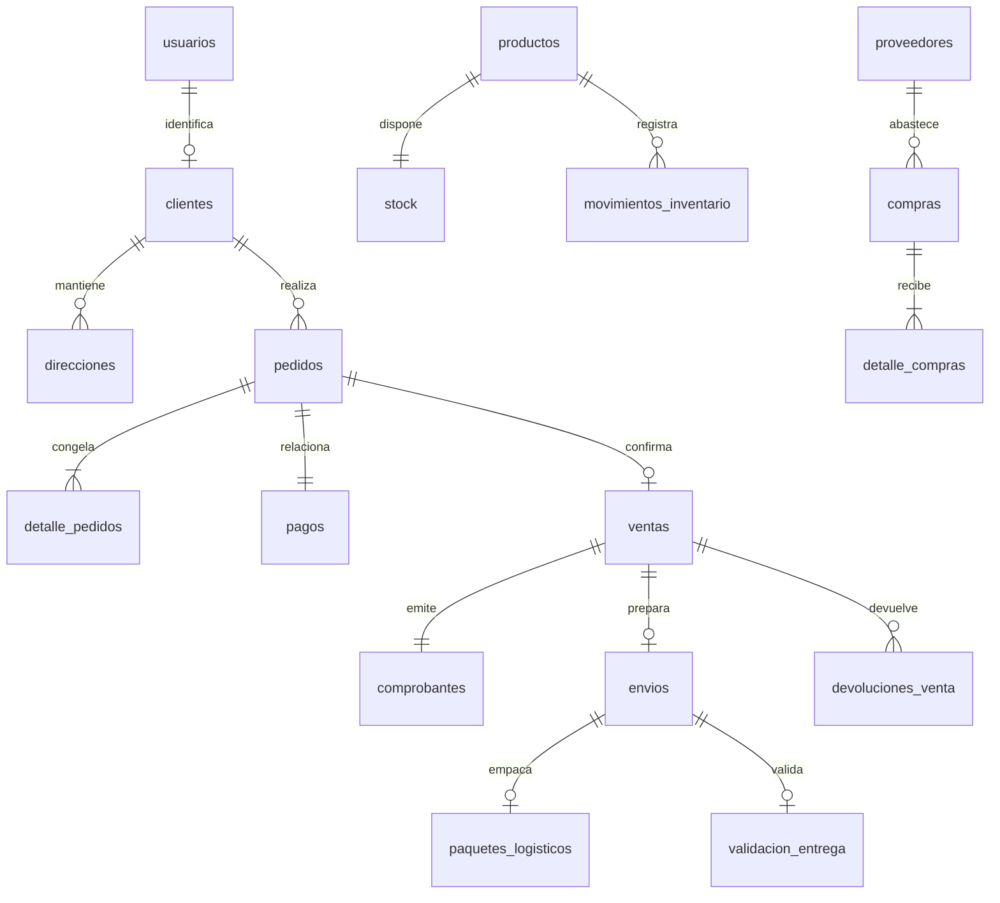

# MySQL y modelo de datos

Usar MySQL 8.0 con InnoDB, UTF-8 y fechas UTC. La base de esta entrega es `la_cosecha_soa`; no importar el dump completo de la versión vieja. Conserva la base `la_cosecha` si contiene datos anteriores. El error «tablas ajenas» es una protección deliberada.

## Preparación

En MySQL Workbench, conectado como administrador, crea la base y el usuario de aplicación. Sustituye `CONTRASENA_LOCAL_NUEVA` por una contraseña local propia; este texto es sólo un marcador y no debe utilizarse como contraseña.

```sql
CREATE DATABASE la_cosecha_soa CHARACTER SET utf8mb4 COLLATE utf8mb4_0900_ai_ci;
CREATE USER 'la_cosecha_app'@'localhost' IDENTIFIED BY 'CONTRASENA_LOCAL_NUEVA';
GRANT ALL PRIVILEGES ON la_cosecha_soa.* TO 'la_cosecha_app'@'localhost';
```

No ejecutar estos comandos sobre un usuario/base existente sin revisar sus permisos. `ALL` queda limitado a la base del proyecto y permite las migraciones; no concede administración global. Si MySQL identifica la conexión TCP con otro host, configura el host correcto del usuario. Después completa `.env` y ejecuta `npm run db:migrate` seguido de `npm run db:seed`.

El migrador adquiere un bloqueo, verifica el marcador exclusivo `la-cosecha-soa-v3`, conserva checksums y registra el paso DDL aplicado. Una base no vacía sin ese marcador se rechaza antes de modificar sus tablas. MySQL confirma DDL implícitamente: no se promete rollback de una migración entera. El contador y la detección de columnas/índices permiten continuar un corte; no edites una migración ya aplicada.

## Migraciones

| Archivo | Contenido |
|---|---|
| `001_estructura.sql` | Modelo académico en español, claves foráneas y restricciones; sin datos personales del dump. |
| `002_seguridad_operaciones.sql` | Versiones de sesión, bloqueo, reservas, idempotencia, eventos de pago y paquetes logísticos. |
| `003_comprobantes_pendientes.sql` | Cola de correo persistente. |
| `004_trazabilidad.sql` | Instantáneas de pedido/cliente/domicilio/producto, identidad del destinatario/operador, referencia del catálogo y auditoría de roles. |
| `005_reembolsos.sql` | ID y estado del reembolso Stripe, con unicidad. |

El script agrega roles canónicos y un único tipo de pago Tarjeta. `seed.mjs` importa `catalogo.json` con 15 nombres, precios y fotografías de referencia. `referencia_catalogo` impide duplicarlos. Stock inicial cero; costo/proveedor desconocidos quedan nulos. La referencia de origen se conserva, sin copiar usuarios, contraseñas, pedidos ni operaciones anteriores.

## Relaciones principales



`compras` son órdenes a proveedores y `pedidos` son solicitudes de clientes. `devoluciones_compra` y `devoluciones_venta` tienen límites y flujos distintos. `empaquetado` registra envasado del producto; `paquetes_logisticos` se relaciona con un envío. No almacenar PAN ni CVV: la tabla `tarjetas` del modelo académico admite referencias y últimos dígitos, pero no es utilizada por Stripe Checkout ni por los endpoints de la aplicación.

## Verificación reproducible

```sql
SELECT nombre,estado,paso FROM schema_migrations ORDER BY nombre;
SELECT COUNT(*) AS productos FROM productos;
SELECT p.nombre,s.stock_actual FROM productos p JOIN stock s ON s.id_producto=p.id;
SELECT estado,COUNT(*) AS cantidad FROM pedidos GROUP BY estado;
```

Para pruebas automatizadas usa exclusivamente `compose.qa.yml`, puerto **33306**, base `la_cosecha_soa_test`; las suites rechazan otros destinos. Los registros sintéticos llevan un UUID y se eliminan por sus IDs. `qa:down` conserva el volumen QA; no se entrega ningún comando que borre la base de uso diario.

El esquema fue aceptado por MySQL 8.0.46 en inicialización sin red. Esto no verifica el cliente mysql2, el migrador conectado, la concurrencia o los flujos HTTP; esos resultados están pendientes en [VERIFICACIONES](VERIFICACIONES.md).
